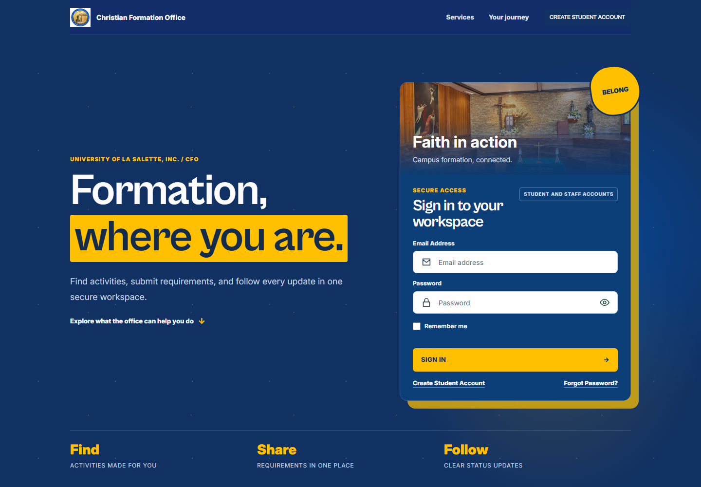
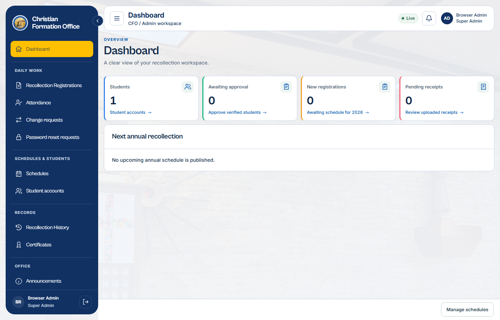
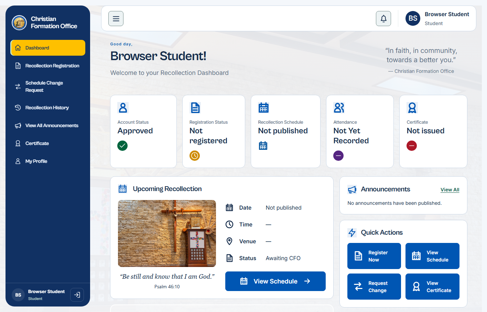

# CFOv2

CFOv2 is a Laravel 12 registration and attendance system for the Christian Formation Office. It gives students one place to register for recollections, follow schedules and requests, receive announcements, and access certificates while office staff manage the complete workflow.



## System preview

The screenshots below are captured from the current application with isolated local demo data.

| Admin workspace | Student workspace |
| --- | --- |
|  |  |

## Current features

### Student workspace

- Gmail-verified student account registration with a generated CFO login identity
- Recollection registration, receipt upload, resubmission, and yearly history
- Published schedule selection and schedule change requests
- Status notifications and office announcements
- Attendance and certificate status, certificate viewing, and profile security
- Session-bound password recovery with in-person office approval

### Office workspace

- Separate CFO Staff and Super Admin permissions
- Student account review, approval, rejection, and password recovery
- Course-, year-, and section-aware schedule creation and publishing
- Registration review, schedule assignment, receipt verification, and attendance
- Batch completion and archival without deleting historical records
- Automatic certificates and a visual certificate template editor
- Announcement drafts, publishing, activity history, and live navigation counts
- Super Admin management of staff accounts, academic options, and system settings

## Technology

- PHP 8.2+ and Laravel 12
- MySQL or MariaDB
- Blade templates with JavaScript and CSS
- Vite 7 and Tailwind CSS 4 build tooling
- PHPUnit feature and unit tests

## Requirements

- PHP 8.2 or newer with the extensions required by Laravel and your database driver
- Composer
- Node.js and npm
- MySQL or MariaDB

## Local installation

Clone the repository and install the locked dependencies:

```powershell
git clone https://github.com/Vernsmoke/CFOv2.git
cd CFOv2
composer install
npm ci
Copy-Item .env.example .env
```

Create the database using phpMyAdmin or MySQL:

```sql
CREATE DATABASE cfov2
CHARACTER SET utf8mb4
COLLATE utf8mb4_unicode_ci;
```

For local development, update the relevant values in `.env`:

```env
APP_ENV=local
APP_DEBUG=true
APP_URL=http://127.0.0.1:8000

DB_CONNECTION=mysql
DB_HOST=127.0.0.1
DB_PORT=3306
DB_DATABASE=cfov2
DB_USERNAME=root
DB_PASSWORD=

CFO_DEMO_ACCOUNTS_ENABLED=true
CFO_DEMO_ACCOUNTS_PASSWORD=ChangeMe123!
```

Generate a unique application key and initialize the application:

```powershell
php artisan key:generate
php artisan migrate --seed
php artisan storage:link
npm run build
php artisan optimize:clear
php artisan serve
```

Open `http://127.0.0.1:8000`.

For active frontend development, use `npm run dev` in another terminal instead of rebuilding after each change.

## Demo accounts

When `CFO_DEMO_ACCOUNTS_ENABLED=true`, `php artisan migrate --seed` creates the following accounts for local or testing environments only.

| Role | Email | Password |
| --- | --- | --- |
| Super Admin | `interface.admin@cfo.office.com` | `ChangeMe123!` |
| CFO Staff | `interface.staff@cfo.office.com` | `ChangeMe123!` |
| Student | `interface.student@cfo.office.com` | `ChangeMe123!` |

For production, keep `CFO_DEMO_ACCOUNTS_ENABLED=false` and configure a unique first administrator through `CFO_DEFAULT_ADMIN_EMAIL` and `CFO_DEFAULT_ADMIN_PASSWORD` before seeding.

## Account roles

- **Student** accounts are created through public registration and can access only their own profile, registrations, schedules, receipts, notifications, and certificates.
- **CFO Staff** accounts are created by a Super Admin under **Settings → Staff accounts**. They can perform daily office workflows but cannot manage staff, system settings, academic reference data, certificate templates, or activity logs.
- **Super Admin** accounts have full office access. The role migration converts existing legacy `Admin` accounts to `SuperAdmin`.

To provision another Super Admin from the server console:

```powershell
php artisan cfo:create-super-admin person@example.com --name="Full Name"
```

The public account form creates students only. CFO Staff receive a one-time password from a Super Admin and must change it within 24 hours.

## Verification

Run the automated test suite and production asset build before deploying changes:

```powershell
php artisan test
npm run build
```

## Production and operations

- [Production setup](docs/production.md)
- [Design transfer notes](docs/design-transfer.md)
- [Absence and re-registration workflow](docs/absence-reregistration.md)
- [Admin sidebar architecture](docs/admin-sidebar.md)

In production, serve only the `public/` directory, use a dedicated database account, configure SMTP, set `APP_DEBUG=false`, and run the queue worker under a process manager.

## Security notes

- Never commit `.env`, production database exports, uploaded receipts, or recovery secrets.
- Generate a unique `APP_KEY` for every installation.
- Never enable the shared demo accounts in production.
- The repository contains database migrations and demo seeders, not real user data.
- Review file storage, proxy, session-cookie, mail, queue, and live-transport settings before deployment.

## Resetting a local database

```powershell
php artisan migrate:fresh --seed
```

> [!WARNING]
> This command permanently deletes all data in the configured database. Use it only for disposable local or test data.
